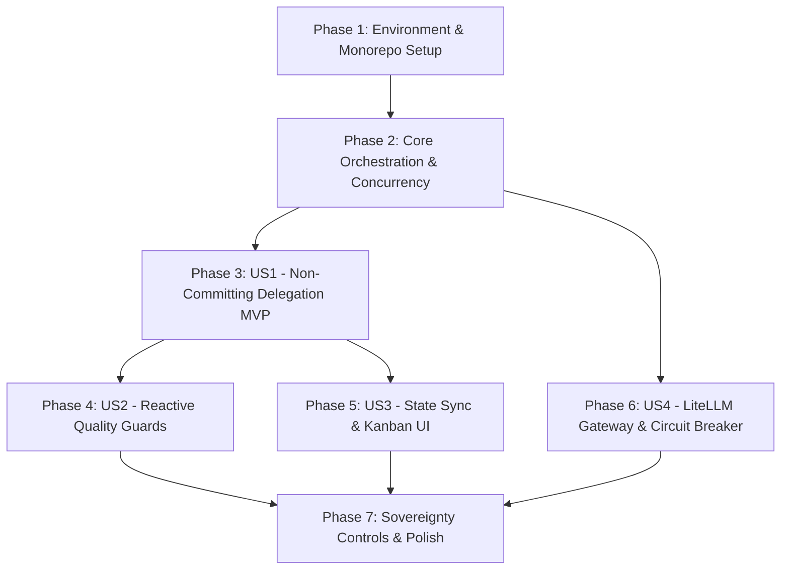

# Tasks: Autonomous Multi-Agent Software Engineering Platform

**Input**: Design documents from `specs/001-multi-agent-platform/`  
**Prerequisites**: [plan.md](file:///home/tarikelmallah/Projects/GraywolfSquad/specs/001-multi-agent-platform/plan.md), [spec.md](file:///home/tarikelmallah/Projects/GraywolfSquad/specs/001-multi-agent-platform/spec.md), [research.md](file:///home/tarikelmallah/Projects/GraywolfSquad/specs/001-multi-agent-platform/research.md), [data-model.md](file:///home/tarikelmallah/Projects/GraywolfSquad/specs/001-multi-agent-platform/data-model.md), [contracts/relay-result.json](file:///home/tarikelmallah/Projects/GraywolfSquad/specs/001-multi-agent-platform/contracts/relay-result.json)

---

## Phase 1: Environment & Project Scaffolding

**Purpose**: Monorepo workspace initialization, dependency declarations, and infrastructure container topology.

- [ ] T001 Initialize root monorepo configuration with `pnpm-workspace.yaml` and root `package.json`
- [ ] T002 [P] Scaffold package skeleton for backend orchestrator in `packages/orchestrator/package.json` and `packages/orchestrator/tsconfig.json`
- [ ] T003 [P] Scaffold package skeleton for frontend dashboard in `packages/dashboard/package.json` and `packages/dashboard/vite.config.ts`
- [ ] T004 [P] Scaffold package skeleton for execution harness in `packages/relay/package.json`
- [ ] T005 [P] Create local `.agents/` runtime directories for tasks and locks: `mkdir -p .agents/{tasks,locks}`
- [ ] T006 Define multi-service Docker Compose topology in `packages/gateway/docker-compose.yml` (Node.js orchestrator, Valkey 7.2+, LiteLLM proxy, and PostgreSQL 16+ with pgvector)
- [ ] T007 [P] Create PostgreSQL database initialization script with `vector` extension and tasks schema in `packages/gateway/init-db.sql`
- [ ] T008 [P] Configure environment template `.env.example` with API keys, database URLs, and port mappings

---

## Phase 2: Core Orchestration & Concurrency Engine (Foundational)

**Purpose**: Atomic file locking, filesystem event ingestion, relative-path Git worktrees, and Docker sandbox mounts.  
**⚠️ CRITICAL**: Must be completed before autonomous agent task execution can begin.

- [ ] T009 Implement `FileLockProxy` using `proper-lockfile` directory-based atomic locking with 30s stale recovery in `packages/orchestrator/src/locking/file-lock-proxy.ts`
- [ ] T010 Unit test `FileLockProxy` for concurrent acquisition, contention rejections, and stale-lock recovery in `packages/orchestrator/tests/locking/file-lock-proxy.test.ts`
- [ ] T011 Implement task brief markdown and frontmatter parser using `gray-matter` and `zod` in `packages/orchestrator/src/watcher/frontmatter-parser.ts`
- [ ] T012 Implement Chokidar filesystem watcher for `.agents/tasks/**` hierarchy with debounce in `packages/orchestrator/src/watcher/task-watcher.ts`
- [ ] T013 Implement relative-path Git worktree provisioning utility (`git worktree add` with relative pointer resolution) in `packages/orchestrator/src/sandbox/worktree-manager.ts`
- [ ] T014 Implement Dockerode container sandbox runner with scoped bind mounts (`/workspace` RW, `.agents/` RO) and `safe.directory` config in `packages/orchestrator/src/sandbox/container-runner.ts`
- [ ] T015 Initialize Fastify HTTP & WebSocket server routing and lifecycle hooks in `packages/orchestrator/src/api/server.ts`

---

## Phase 3: User Story 1 - Non-Committing Task Delegation & Sandbox Execution (Priority: P1) 🎯 MVP

**Goal**: Provision an isolated Git worktree, execute the agent inside an ephemeral Docker container via `relay.mjs`, and emit `result.json` without modifying host branches or creating Git commits.  
**Independent Test**: Trigger task delegation, verify agent executes shell commands and edits files within `/workspace`, traps OS signals, and outputs `result.json` without any Git commits on the repository.

- [ ] T016 [US1] Create the zero-dependency relay execution script in `packages/relay/relay.mjs`
- [ ] T017 [US1] Integrate `delegate-relay.result.v1` JSON Schema validator in `packages/relay/src/validator.ts`
- [ ] T018 [US1] Implement process execution, memory/duration telemetry tracking, and signal trapping (`SIGINT`/`SIGTERM`) in `packages/relay/relay.mjs`
- [ ] T019 [US1] Implement touched-files extraction and unified diff generation (`changes.patch`) in `packages/orchestrator/src/sandbox/diff-extractor.ts`
- [ ] T020 [US1] Implement sandbox execution dispatcher connecting task brief queue to container lifecycle in `packages/orchestrator/src/sandbox/dispatcher.ts`
- [ ] T021 [US1] Integration test verifying non-committing sandbox run and `result.json` generation in `packages/orchestrator/tests/sandbox/delegation.test.ts`

---

## Phase 4: User Story 2 - Reactive Quality Assurance Gates & Diff Verification (Priority: P2)

**Goal**: Automatically evaluate generated code diffs against Clean-Code, Test, and Documentation Guards before presenting changes for developer review.  
**Independent Test**: Feed synthetic patches containing empty catch blocks, hallucinated imports, or mocked internal domain objects into the guard pipeline, and assert that the task halts and triggers a QA Fixer pass.

- [ ] T022 [P] [US2] Implement AST-based Clean-Code Guard (flags empty catches, hallucinated imports, dead code) in `packages/orchestrator/src/guards/clean-code-guard.ts`
- [ ] T023 [P] [US2] Implement Test Guard (validates mock boundaries at infrastructure interfaces only) in `packages/orchestrator/src/guards/test-guard.ts`
- [ ] T024 [P] [US2] Implement Documentation Guard (validates API signatures and env vars match code diffs) in `packages/orchestrator/src/guards/doc-guard.ts`
- [ ] T025 [US2] Implement sequential guard pipeline coordinator generating `verification.md` in `packages/orchestrator/src/guards/guard-coordinator.ts`
- [ ] T026 [US2] Implement automated sandbox test runner verifying exit code 0 inside the container in `packages/orchestrator/src/guards/sandbox-test-runner.ts`
- [ ] T027 [US2] Integration test verifying guard rejection of defective diffs and advancement of clean diffs in `packages/orchestrator/tests/guards/guard-pipeline.test.ts`

---

## Phase 5: User Story 3 - Filesystem-Centric State Sync & Dual Interface (Priority: P3)

**Goal**: Synchronize `.agents/tasks/` state transitions in real time to the React UI via WebSockets and propagate developer disk edits back to the orchestrator.  
**Independent Test**: Edit a task's frontmatter in `.agents/tasks/TASK-001/brief.md` in a text editor, verify WebSocket broadcasts change, and confirm card moves in the Kanban board within 500ms.

- [ ] T028 [US3] Implement WebSocket event broadcaster for task status changes, logs, and diff updates in `packages/orchestrator/src/api/websocket-broadcaster.ts`
- [ ] T029 [P] [US3] Scaffold React + Tailwind + Shadcn UI base theme and layout in `packages/dashboard/src/App.tsx`
- [ ] T030 [P] [US3] Implement WebSocket client hook `useTaskEvents` with automatic reconnect in `packages/dashboard/src/hooks/use-task-events.ts`
- [ ] T031 [US3] Implement visual Kanban board component with lanes (`Queued`, `In Progress`, `Verifying`, `Human Review`, `Merged`) in `packages/dashboard/src/components/KanbanBoard.tsx`
- [ ] T032 [US3] Implement real-time task card component with model alias, token spend, and duration timers in `packages/dashboard/src/components/TaskCard.tsx`
- [ ] T033 [US3] Implement bidirectional Markdown editor viewer with frontmatter schema validation in `packages/dashboard/src/components/MarkdownEditor.tsx`

---

## Phase 6: User Story 4 - LiteLLM Gateway & Budget Circuit Breaking (Priority: P4)

**Goal**: Route agent LLM requests through a centralized LiteLLM proxy with virtual roles, rate limits, spend caps, and automatic stuck-detection heuristics.  
**Independent Test**: Configure a task spend cap of $2.00 USD, trigger repetitive reasoning loops, and confirm the circuit breaker trips and halts the container.

- [ ] T034 [P] [US4] Configure LiteLLM proxy routing matrix (`agent-architect`, `agent-coder`, `agent-qa`, `agent-reviewer`) in `packages/gateway/config.yaml`
- [ ] T035 [US4] Implement token consumption tracker and per-task spend counter in `packages/orchestrator/src/gateway/spend-tracker.ts`
- [ ] T036 [US4] Implement stuck-detection heuristics (halts on 4 identical action-observations or 3 identical diffs) in `packages/orchestrator/src/gateway/stuck-detector.ts`
- [ ] T037 [US4] Implement proxy circuit-breaker listener for HTTP 429/500 provider failovers in `packages/orchestrator/src/gateway/circuit-breaker.ts`
- [ ] T038 [US4] Integration test verifying spend cap enforcement and stuck loop container pause in `packages/orchestrator/tests/gateway/spend-circuit.test.ts`

---

## Phase 7: Polish & Developer Sovereignty Controls

**Purpose**: Xterm.js streaming terminal feeds, container runtime pause/resume (`SIGSTOP`/`SIGCONT`), in-place code override, and manual merge gates.

- [ ] T039 Implement Xterm.js streaming terminal console component in `packages/dashboard/src/components/TerminalFeed.tsx`
- [ ] T040 Implement unified diff viewer component highlighting `changes.patch` in `packages/dashboard/src/components/DiffViewer.tsx`
- [ ] T041 Implement container pause/resume controls (`docker pause` / `docker unpause`) in `packages/orchestrator/src/sandbox/container-controls.ts`
- [ ] T042 Implement human review gate actions (Approve & Merge, Reject & Re-queue, Edit in-place) in `packages/orchestrator/src/api/review-routes.ts`
- [ ] T043 Wire up review action buttons on the dashboard review modal in `packages/dashboard/src/components/ReviewGateModal.tsx`
- [ ] T044 End-to-end smoke test verifying full lifecycle: delegation -> sandbox -> guard -> dashboard review -> merge in `packages/orchestrator/tests/e2e/lifecycle.test.ts`

---

## Dependencies & Execution Order

### Parallel Opportunities

- **Phase 1**: T002, T003, T004, T005, T007, T008 can be scaffolded in parallel.
- **Phase 2**: T011 and T013 can proceed in parallel once T009 is complete.
- **Phase 4**: T022 (Clean-Code Guard), T023 (Test Guard), and T024 (Doc Guard) can be authored completely in parallel.
- **Phase 5**: Frontend scaffolding (T029, T030) can run in parallel with backend WebSocket routes (T028).

---

## Implementation Strategy: MVP First

1. **Milestone 1 (Tasks T001–T021)**: Delivers a functional CLI-driven MVP where a developer creates `brief.md`, an agent executes in a Docker container with Git worktree isolation, and produces `result.json` + `changes.patch` with zero Git commits.
2. **Milestone 2 (Tasks T022–T027)**: Adds autonomous quality assurance, filtering synthetic bugs via Clean-Code, Test, and Doc Guards.
3. **Milestone 3 (Tasks T028–T038)**: Integrates LiteLLM governance, spend caps, and the real-time visual Kanban UI.
4. **Milestone 4 (Tasks T039–T044)**: Completes the developer sovereignty interface with streaming Xterm terminals and manual review gates.
