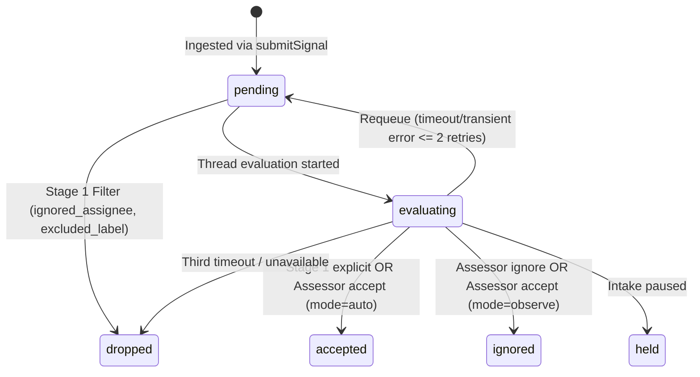
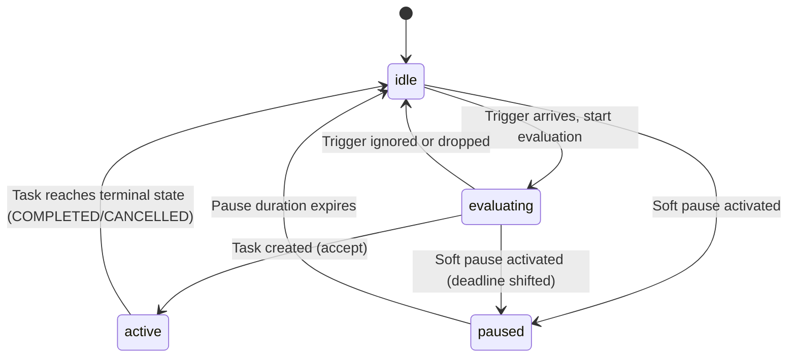

# Data Model & Schema Specification: Attention Firewall & Two-Stage Signal Admission (`021-attention-firewall`)

**Date**: 2026-11-05  
**Spec Reference**: [spec.md](file:///home/tarikelmallah/Projects/GraywolfSquad/specs/021-attention-firewall/spec.md)  
**Database**: PostgreSQL 16 with Row-Level Security (`app.current_workspace_id`)  
**Schema Standard**: `@sinclair/typebox`

---

## 1. Relational Database Schema (PostgreSQL 16)

The migration is defined in `migrations/1789444040217_create_attention_firewall.js`.

```sql
-- 1. Versioned Signal Policies
CREATE TABLE signal_policies (
  id UUID PRIMARY KEY DEFAULT gen_random_uuid(),
  workspace_id UUID NOT NULL REFERENCES workspaces(id) ON DELETE CASCADE,
  project_id UUID NOT NULL REFERENCES projects(id) ON DELETE CASCADE,
  version_hash VARCHAR(64) NOT NULL, -- SHA-256 canonical hash of rules + settings
  mode VARCHAR(16) NOT NULL DEFAULT 'observe' CHECK (mode IN ('off', 'observe', 'auto')),
  rules JSONB NOT NULL DEFAULT '[]'::jsonb,
  settings JSONB NOT NULL DEFAULT '{}'::jsonb,
  is_active BOOLEAN NOT NULL DEFAULT true,
  created_at TIMESTAMPTZ NOT NULL DEFAULT NOW(),
  created_by UUID REFERENCES users(id) ON DELETE SET NULL
);

CREATE UNIQUE INDEX idx_signal_policies_active ON signal_policies(project_id) WHERE is_active = true;
CREATE INDEX idx_signal_policies_lookup ON signal_policies(workspace_id, project_id, version_hash);

-- 2. Signal Threads (Correlated external conversations: issues, PRs, chat threads)
CREATE TABLE signal_threads (
  id UUID PRIMARY KEY DEFAULT gen_random_uuid(),
  workspace_id UUID NOT NULL REFERENCES workspaces(id) ON DELETE CASCADE,
  project_id UUID NOT NULL REFERENCES projects(id) ON DELETE CASCADE,
  source_type VARCHAR(32) NOT NULL, -- e.g. 'github-issue', 'slack-thread', 'discord-thread'
  external_thread_id VARCHAR(255) NOT NULL, -- e.g. 'malah-code/graywolf-squad#142'
  title TEXT NOT NULL,
  status VARCHAR(32) NOT NULL DEFAULT 'idle' CHECK (status IN ('idle', 'evaluating', 'active', 'paused')),
  active_task_id VARCHAR(64) REFERENCES tasks(id) ON DELETE SET NULL,
  metadata JSONB NOT NULL DEFAULT '{}'::jsonb,
  created_at TIMESTAMPTZ NOT NULL DEFAULT NOW(),
  updated_at TIMESTAMPTZ NOT NULL DEFAULT NOW(),
  CONSTRAINT uq_signal_threads_external UNIQUE (workspace_id, project_id, source_type, external_thread_id)
);

CREATE INDEX idx_signal_threads_active_task ON signal_threads(workspace_id, active_task_id);

-- 3. Signal Triggers (Atomic incoming events)
CREATE TABLE signal_triggers (
  id UUID PRIMARY KEY DEFAULT gen_random_uuid(),
  workspace_id UUID NOT NULL REFERENCES workspaces(id) ON DELETE CASCADE,
  project_id UUID NOT NULL REFERENCES projects(id) ON DELETE CASCADE,
  thread_id UUID NOT NULL REFERENCES signal_threads(id) ON DELETE CASCADE,
  external_event_id VARCHAR(255) NOT NULL,
  actor_handle VARCHAR(128) NOT NULL,
  action VARCHAR(64) NOT NULL, -- 'opened', 'comment_created', 'labeled', 'mentioned'
  strength VARCHAR(16) NOT NULL CHECK (strength IN ('explicit', 'inferred')),
  payload JSONB NOT NULL,
  disposition VARCHAR(32) NOT NULL DEFAULT 'pending' 
    CHECK (disposition IN ('pending', 'evaluating', 'accepted', 'ignored', 'held', 'dropped')),
  reason_code VARCHAR(64),
  received_at TIMESTAMPTZ NOT NULL DEFAULT NOW(),
  evaluated_at TIMESTAMPTZ
);

CREATE INDEX idx_signal_triggers_thread_disp ON signal_triggers(workspace_id, thread_id, disposition);
CREATE INDEX idx_signal_triggers_received ON signal_triggers(workspace_id, received_at DESC);

-- 4. Signal Decisions (Evaluation audit log)
CREATE TABLE signal_decisions (
  id UUID PRIMARY KEY DEFAULT gen_random_uuid(),
  workspace_id UUID NOT NULL REFERENCES workspaces(id) ON DELETE CASCADE,
  project_id UUID NOT NULL REFERENCES projects(id) ON DELETE CASCADE,
  thread_id UUID NOT NULL REFERENCES signal_threads(id) ON DELETE CASCADE,
  primary_trigger_id UUID NOT NULL REFERENCES signal_triggers(id) ON DELETE CASCADE,
  batched_trigger_ids JSONB NOT NULL DEFAULT '[]'::jsonb,
  policy_id UUID NOT NULL REFERENCES signal_policies(id),
  policy_version_hash VARCHAR(64) NOT NULL,
  verdict VARCHAR(16) NOT NULL CHECK (verdict IN ('accept', 'ignore', 'unavailable')),
  reason_code VARCHAR(64) NOT NULL, -- 'rule_matched', 'observed', 'direction_unsettled', 'no_rule_matched', 'timeout', etc.
  mandate JSONB, -- Populated if verdict = 'accept'
  proposal JSONB, -- Populated if verdict = 'ignore' and reason_code = 'observed'
  rule_assessments JSONB NOT NULL DEFAULT '[]'::jsonb,
  intent_evidence JSONB,
  evaluation_duration_ms INTEGER NOT NULL,
  requeue_count SMALLINT NOT NULL DEFAULT 0,
  created_at TIMESTAMPTZ NOT NULL DEFAULT NOW()
);

CREATE INDEX idx_signal_decisions_project ON signal_decisions(workspace_id, project_id, created_at DESC);
CREATE INDEX idx_signal_decisions_observed ON signal_decisions(workspace_id, project_id, verdict, reason_code)
  WHERE verdict = 'ignore' AND reason_code = 'observed';

-- 5. Task Table Extension (Immutable Mandate)
ALTER TABLE tasks ADD COLUMN IF NOT EXISTS mandate JSONB;
CREATE INDEX idx_tasks_mandate_gin ON tasks USING gin(mandate);

-- 6. Row-Level Security Policies (Tenant Isolation)
ALTER TABLE signal_policies ENABLE ROW LEVEL SECURITY;
ALTER TABLE signal_policies FORCE ROW LEVEL SECURITY;
CREATE POLICY workspace_isolation ON signal_policies FOR ALL
  USING (workspace_id = NULLIF(current_setting('app.current_workspace_id', true), '')::UUID)
  WITH CHECK (workspace_id = NULLIF(current_setting('app.current_workspace_id', true), '')::UUID);

ALTER TABLE signal_threads ENABLE ROW LEVEL SECURITY;
ALTER TABLE signal_threads FORCE ROW LEVEL SECURITY;
CREATE POLICY workspace_isolation ON signal_threads FOR ALL
  USING (workspace_id = NULLIF(current_setting('app.current_workspace_id', true), '')::UUID)
  WITH CHECK (workspace_id = NULLIF(current_setting('app.current_workspace_id', true), '')::UUID);

ALTER TABLE signal_triggers ENABLE ROW LEVEL SECURITY;
ALTER TABLE signal_triggers FORCE ROW LEVEL SECURITY;
CREATE POLICY workspace_isolation ON signal_triggers FOR ALL
  USING (workspace_id = NULLIF(current_setting('app.current_workspace_id', true), '')::UUID)
  WITH CHECK (workspace_id = NULLIF(current_setting('app.current_workspace_id', true), '')::UUID);

ALTER TABLE signal_decisions ENABLE ROW LEVEL SECURITY;
ALTER TABLE signal_decisions FORCE ROW LEVEL SECURITY;
CREATE POLICY workspace_isolation ON signal_decisions FOR ALL
  USING (workspace_id = NULLIF(current_setting('app.current_workspace_id', true), '')::UUID)
  WITH CHECK (workspace_id = NULLIF(current_setting('app.current_workspace_id', true), '')::UUID);
```

---

## 2. TypeScript & TypeBox Domain Models

Located in `src/orchestrator/admission/core/model.ts` and `src/orchestrator/admission/core/policy.ts`:

```typescript
import { Type, Static } from '@sinclair/typebox';

// --- STRENGTH & ADMISSION MATRIX ---

export const StrengthSchema = Type.Union([
  Type.Literal('explicit'),
  Type.Literal('inferred'),
]);
export type Strength = Static<typeof StrengthSchema>;

export const AdmissionCellSchema = Type.Union([
  Type.Literal('listedUnaddressed'),
  Type.Literal('unlistedAddressed'),
  Type.Literal('unlistedUnaddressed'),
]);
export type AdmissionCell = Static<typeof AdmissionCellSchema>;

export const AdmissionOptionSchema = Type.Union([
  Type.Literal('explicit'),
  Type.Literal('inferred'),
  Type.Literal('ignore'),
]);
export type AdmissionOption = Static<typeof AdmissionOptionSchema>;

export const AdmissionRowSchema = Type.Object({
  listedUnaddressed: Type.Optional(Type.Union([Type.Literal('inferred'), Type.Literal('ignore')])),
  unlistedAddressed: Type.Optional(Type.Union([Type.Literal('explicit'), Type.Literal('inferred'), Type.Literal('ignore')])),
  unlistedUnaddressed: Type.Optional(Type.Union([Type.Literal('inferred'), Type.Literal('ignore')])),
});
export type AdmissionRow = Static<typeof AdmissionRowSchema>;

// --- MANDATE & MANDATE BASIS ---

export const MandateBasisSchema = Type.Object({
  via: Type.Union([
    Type.Literal('addressed'),
    Type.Literal('followup'),
    Type.Literal('admission'),
    Type.Literal('listed'),
    Type.Literal('bot'),
    Type.Literal('manual'),
  ]),
  sourceThreadId: Type.String(),
  primaryTriggerId: Type.String({ format: 'uuid' }),
  authorizedBy: Type.String(),
  reason: Type.String(),
  cell: Type.Optional(AdmissionCellSchema),
  rules: Type.Optional(Type.Array(Type.String())),
});
export type MandateBasis = Static<typeof MandateBasisSchema>;

export const MandateSchema = Type.Object({
  mandateId: Type.String({ format: 'uuid' }),
  policyVersion: Type.String({ pattern: '^[0-9a-f]{64}$' }),
  strength: StrengthSchema,
  scope: Type.Object({
    repo: Type.String(),
    writableScope: Type.Array(Type.String()),
    maxBudgetUsd: Type.Number({ minimum: 0 }),
  }),
  basis: MandateBasisSchema,
  issuedAt: Type.String({ format: 'date-time' }),
});
export type Mandate = Static<typeof MandateSchema>;

// --- RULES & ASSESSOR SCHEMAS ---

export const RuleSchema = Type.Object({
  id: Type.String({ pattern: '^[a-zA-Z0-9_-]{1,80}$' }),
  name: Type.String({ minLength: 1, maxLength: 100 }),
  enabled: Type.Boolean(),
  instruction: Type.String({ minLength: 1, maxLength: 2000 }),
});
export type Rule = Static<typeof RuleSchema>;

export const RuleAssessmentSchema = Type.Object({
  rule_id: Type.String(),
  matched: Type.Boolean(),
  reason: Type.String({ maxLength: 500 }),
});
export type RuleAssessment = Static<typeof RuleAssessmentSchema>;

export const AdmissionDirectionSchema = Type.Object({
  implementation_requested: Type.Boolean(),
  target_basis: Type.Union([
    Type.Literal('specified'),
    Type.Literal('existing-standard'),
    Type.Literal('undetermined'),
  ]),
  requires_design_decision: Type.Boolean(),
  evidence: Type.String({ maxLength: 700 }),
});
export type AdmissionDirection = Static<typeof AdmissionDirectionSchema>;

export const AssessorOutcomeSchema = Type.Object({
  decision: Type.Union([
    Type.Literal('accept'),
    Type.Literal('ignore'),
    Type.Literal('unavailable'),
  ]),
  direction: AdmissionDirectionSchema,
  rule_assessments: Type.Array(RuleAssessmentSchema),
  title: Type.String({ maxLength: 200 }),
  scope: Type.String({ maxLength: 500 }),
  reason: Type.String({ maxLength: 500 }),
  intent_evidence: Type.Optional(Type.String({ maxLength: 500 })),
  worktree_name: Type.Optional(Type.String({ maxLength: 64 })),
});
export type AssessorOutcome = Static<typeof AssessorOutcomeSchema>;

// --- PROPOSAL & DECISION ---

export const ObservedProposalSchema = Type.Object({
  title: Type.String(),
  scope: Type.String(),
  worktree_name: Type.Optional(Type.String()),
});
export type ObservedProposal = Static<typeof ObservedProposalSchema>;
```

---

## 3. State Machine Transitions

### 3.1 Trigger Disposition Lifecycle



### 3.2 Thread Status Lifecycle



